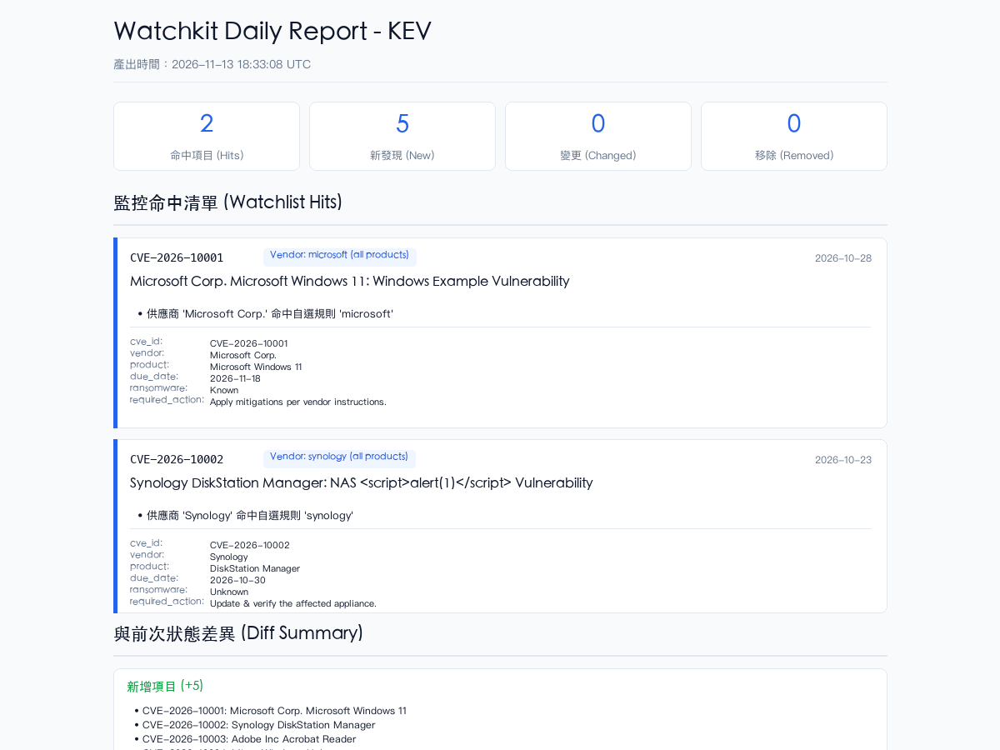

# watchkit



```bash
git clone https://github.com/fish0119freelancer/watchkit.git && cd watchkit
sh examples/run_demo.sh
open examples/out/kev-report.html
```

`watchkit` is a lightweight, zero-dependency (Python 3.10+ standard library only) open-source framework designed for "public data watch -> watchlist matching -> daily HTML report generation".

It provides local caching, retry with backoff, state diffing (new, changed, removed items), and standalone responsive HTML reports with dark mode.

---

## Key Features

- **Zero External Dependencies**: Powered entirely by the Python standard library (`urllib`, `dataclasses`, `html`, `json`, etc.).
- **Watcher Protocol**: Implement a new public data watcher in approximately 40 lines of code.
- **State Diff Tracking**: Compares current runs against previous state snapshots to highlight new, changed, and removed items.
- **Self-Contained Reports**: Emits a single, secure HTML document. All dynamic data is escaped, with zero external JavaScript and built-in adaptive dark mode.
- **Clean Notifier Interface**: Includes stdout and file notifiers out of the box, with zero hard-coded credentials or proprietary communication client SDKs.

---

## Installation

Install directly from GitHub:

```bash
pip install git+https://github.com/fish0119freelancer/watchkit
```

> **Note**: PyPI release is planned but not yet published; please install via GitHub for now.

---

## Quick Start (Offline Demo)

You can run the offline demos using the bundled sample fixtures without network access:

### 1. Run CISA KEV Vulnerability Watch Offline Demo

```bash
# Create sample watchlist
cat << 'EOF' > watchlist_kev.txt
Microsoft: Windows 11
Synology
EOF

# Run watcher and generate HTML report (from repository root, set PYTHONPATH=src)
PYTHONPATH=src python -m watchkit run kev \
  --offline tests/fixtures/kev_sample.json \
  --watchlist watchlist_kev.txt \
  --out kev_report.html \
  --state-dir .watchkit
```

### 2. Run CPSC Recalls Watch Offline Demo

```bash
# Create sample watchlist with keywords and country
cat << 'EOF' > watchlist_cpsc.txt
product: power bank | manufacturer: China
toy
EOF

# Run watcher
PYTHONPATH=src python -m watchkit run cpsc_recalls \
  --offline tests/fixtures/cpsc_sample.json \
  --watchlist watchlist_cpsc.txt \
  --out cpsc_report.html \
  --state-dir .watchkit
```

Open `kev_report.html` or `cpsc_report.html` in any web browser to view the generated report.

---

## How to Write a New Watcher in ~40 Lines

Any class implementing `fetch`, `parse`, and `match` fulfills the `Watcher` protocol:

```python
import json
from pathlib import Path
from typing import Any
from watchkit.core import Hit, Item, Source

class SimpleJsonWatcher:
    name = "simple_feed"

    def __init__(self, url: str = "https://example.invalid/feed.json"):
        self.source = Source(url=url, cache_path=Path(".cache/feed.json"))

    def fetch(self, offline_path: Path | None = None) -> str:
        return self.source.fetch(offline_path=offline_path)

    def parse(self, raw: str) -> list[Item]:
        records = json.loads(raw)
        return [
            Item(
                id=str(row.get("id")),
                title=str(row.get("title")),
                date=str(row.get("date", "")),
                data=row,
            )
            for row in records
        ]

    def match(self, items: list[Item], watchlist: Any) -> list[Hit]:
        keywords = [k.casefold() for k in watchlist if isinstance(k, str)]
        hits = []
        for item in items:
            title_lower = item.title.casefold()
            for kw in keywords:
                if kw in title_lower:
                    hits.append(Hit(
                        item=item,
                        matched_rule=f"keyword: {kw}",
                        reasons=[f"Title contains keyword '{kw}'"],
                    ))
                    break
        return hits
```

---

## Notifiers & Webhooks

`watchkit` prioritizes simplicity and security. The core contains no SMTP, LINE, Telegram, or webhook client credentials:

1. `--notify stdout` (default): Prints summary to standard output for piping or CI/CD logs.
2. `--notify file --notify-file alerts.txt`: Appends summary lines to a designated file.

To send alerts to custom webhooks or chat services, wrap the invocation in a shell script driven by environment variables:

```bash
python -m watchkit run kev --watchlist wl.txt --out report.html

if [ -n "$WEBHOOK_URL" ]; then
  curl -X POST -H "Content-Type: application/json" \
    -d "{\"text\": \"watchkit run completed. Review report.html\"}" \
    "$WEBHOOK_URL"
fi
```

---

## Data Source Terms of Use

- **CISA KEV Catalog**: Maintained by the U.S. Cybersecurity and Infrastructure Security Agency (CISA) as public domain U.S. Government work.
- **CPSC SaferProducts API**: Provided by the U.S. Consumer Product Safety Commission (CPSC). Please review API terms of service, respect rate limits, and verify primary recall notices.

---

## Need a Custom Watcher? (Automation Service)

Need custom watchers for proprietary data feeds, internal vendor notices, or specialized public portals?

- For questions or suggestions, please open an issue on [GitHub Issues](https://github.com/fish0119freelancer/watchkit/issues).
- For custom watchers / automation services: see the author's Fiverr profile (link in the [GitHub profile](https://github.com/fish0119freelancer)).

---

## License

This project is licensed under the [MIT License](LICENSE).
